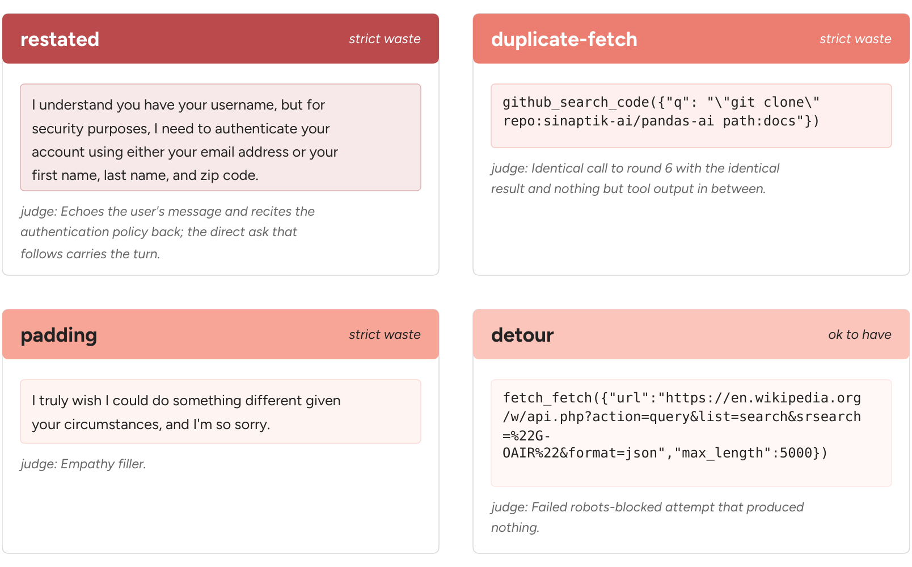

# LLMaJ — LLM-as-a-Judge for token waste

LLMaJ reads an agent's recorded trajectory and identifies, turn by turn, the spans the
agent produced that are useless and removable — content that can be removed without
eliminating useful work from the trajectory. The marked spans are mapped back to the
original trajectory and re-tokenised with the agent model's own tokenizer, so waste is
measured in the tokens that were actually billed, not in characters. It is the measuring
instrument of the paper: every waste number comes from its verdicts.

## What it judges

Three judgings run on every recorded turn, each with its own prompt under `llmaj/prompts/`:

| judging | question | answer | prompt |
|---|---|---|---|
| **efficiency** | which stretches of this turn could be removed without eliminating useful work? | verbatim spans, each assigned to a waste pattern, plus — for anything kept — the later round that would break without it | `llmaj/prompts/efficiency_prompt.py` |
| **utility** | what is this turn's *reasoning* for? | one of eight action categories | `llmaj/prompts/utility_prompt.py` |
| **action** | what do this turn's *visible response and tool calls* do? | the same eight categories, read from the action side | `llmaj/prompts/action_prompt.py` |

### The waste patterns

Waste is defined by a minimalism principle: an agent trajectory should contain no more
generated content than is necessary to preserve the useful work the task requires, so
content is waste when it can be removed without eliminating useful work. Four recurring
patterns are identified in practice:



- **Restate** — the agent repeats information that already exists in the current context:
  quoting a policy that is in the system prompt, paraphrasing a tool response that is still
  in the context, restating the same plan before each step.
- **Duplicate-Fetch** — a repeated tool call that retrieves information already available
  from a previous turn and unchanged since: reading the same file again, repeating the
  same lookup against an unchanged database.
- **Padding** — generated text that does not advance the task: preambles, sign-offs,
  restating the user's request, narrating an action immediately before performing it,
  extended expressions of sympathy.
- **Detour** — exploratory work that appeared reasonable when attempted but turned out to
  be unnecessary: a plausible approach that led nowhere, information retrieved and never
  used.

Restate, Duplicate-Fetch and Padding are **strict waste**: they can be removed without
eliminating useful work, so they are directly avoidable. Detours are reported separately,
because exploration is sometimes necessary — a path can be reasonable given what the
agent knew at the time even if the task could have been completed without it.
(`llmaj/prompts/efficiency_classes.py` also carries an `unread` span kind — produced, and
never read by anything — counted with strict waste.) `TAXONOMY.md` gives the full
definitions and the tie-break rules.

The judge marks spans; it does not pick a class for the turn. Whatever it leaves unmarked
is its claim of necessity, and that claim must name the round that would break. Every
marked span is checked verbatim against the source text; a quote that cannot be located
is rejected, never counted.

### The action categories

The utility and action judgings classify a turn's reasoning and its visible execution
into eight categories (`llmaj/prompts/utility_states.py`):

| category | meaning |
|---|---|
| **Frame** | understand what the task is and what constraints apply — policy, permission, format |
| **Plan** | decide the overall approach or sequence of steps; choosing only the next action does not count |
| **Retrieve** | look up or read information from the environment without changing anything |
| **Interpret** | make sense of information a tool returned before deciding what to do next |
| **Derive** | reach a conclusion from information already available — arithmetic, counting, inference — without looking anything up |
| **Mutate** | create the deliverable itself: write code, make an edit, compose the final response (drafting counts before it is applied or sent) |
| **Verify** | check whether a result matches expectations before any problem has been identified; running a test is a Verify |
| **Recover** | respond when something has gone wrong: diagnose the failure, back out, switch approach |

## The efficiency prompt

What the judge is sent for one trajectory, built by `llmaj/prompts/efficiency_prompt.py`
(`build()` returns the two messages). The system message, exactly as sent:

```text
You audit how an AI agent spent its output tokens.

You get one complete trajectory: every turn it took, in order. Each turn shows
what the agent had just received - the user's message, or the previous tool's
result - and then up to three streams of its own output:

  reasoning  the model's private thinking for this turn
  visible    the text the user would see
  action     the tool calls the turn sent, with their arguments

Received text is marked "from the user" or "from a tool". Neither is audited;
both are input, and you are auditing what the agent produced. They are shown
because they are what makes "was this needed" answerable, and in two directions:
a call that repeats an earlier one is milder when the user asked for it in
between, and reasoning that reads the user's own words back is not new content
however well phrased.

Your job for each stream is to mark what could be removed.

Marking
Quote every stretch of the stream that could be deleted without changing the
outcome. Not a few examples - every one. A stream that is load-bearing overall
still contains sentences that carry nothing, and those are what you are looking
for.

Each quote needs a kind:
  restated         says again what is already in the context - the user's own words, an earlier tool result, or the agent's own earlier turn
  duplicate-fetch  a call whose result is the same as one already in the context, with nothing but tool output in between - nobody asked for it and nothing could have changed
  padding          words with no content: filler openers, commentary on style, sign-offs, restated plans
  detour           a step that need not have been taken at all - a trial, an exploration, a route later abandoned
  unread           produced, and then nothing ever reads it

Copy the text word for word: quotes are located in the source, and one that
cannot be found is recorded as a fabrication rather than a finding.

Up to 40 quotes per stream. If you reach that many, quote the longest
stretches - a cap that binds is reported, so do not compress your answer to fit.

What you keep
Whatever you do not mark is your claim that those characters were load-bearing,
and it is read literally. Two fields state it:

  `kept`: one sentence naming what the unmarked remainder does. If you marked
  the whole stream, say plainly that nothing is left.

  `depended_on_by`: the round number of the work that uses that remainder - the edit
  it enables, the answer it supplies a fact to, the call whose result gets used.
  For reasoning this is often the same round, since a turn's thinking feeds that
  turn's own action. An array; empty when nothing uses any of it.

You are not asked to grade the stream. Necessity is what is left after you mark,
so there is no label to fall back on - a stream you mark nothing in is one you
are asserting was necessary character for character.

Rules
- If nothing at all uses a stream, mark the whole thing and leave `depended_on_by` empty. That is a finding, not a failure to answer.
- Reading the request back is `restated`, even when compressed and even when it is the opening move. So is quoting the standing instructions back, when they are shown to you. Summarising in order to reach a conclusion is not: the conclusion is new, so mark the summary and keep the conclusion.
- Applying a rule is not repeating it. "Basic economy is not refundable" copied out of the standing instructions is `restated`; "this booking is basic economy, so it is not refundable" joins the rule to a fact and the result was in neither. Mark the part that was already written down and keep the part that was not.
- A call repeated with a different result is flagged for you in a note, and it is yours to rule on. If the agent changed something and is confirming the change, the re-check is necessary and you mark nothing. If it was trying a variation that did not help, it is `detour`. The note tells you the result differed; it does not tell you which of those happened.
- Getting the same information twice: the first time stands, the repeats are `duplicate-fetch`. Re-running a test after an edit is not a repeat - the earlier result no longer holds. Re-reading a file nobody touched is.
- Proximity is not necessity. A comment inside a necessary patch, a preamble before a necessary edit, a sign-off after a correct answer: the work around them stays and they go.
- A stream cannot outrank what it serves. Reasoning that sets up a step you marked `detour` is itself at most `detour`.
- Judge against the task, not against whether the run succeeded - you are not told whether it did.
- A repeat the user asked for is still a repeat, but a milder one. Only a repeat with nothing but tool output in between is `duplicate-fetch`. When the customer asked for a double-check in between, the call is `detour`: it could have come out differently and it complied with a request - but the same bytes re-entered the context and the agent already had them.
- Quote word for word. Quotes are located in the source text, and one that is not found there is recorded as a fabrication.

Alignment
Every stream's entry must carry `opening`: the first 25 characters of the
stream you are auditing, copied exactly. Its only job is to prove the entry is
filed against the right turn, so copy it rather than summarising it.

Output
A JSON object with a `turns` array, one entry per turn, in the order given. Each
turn lists only the streams it actually has:

{"turns": [
  {"round": <copied from the input>,
    "streams": [
      {"stream": "reasoning",
        "opening": "<first 25 characters, word for word>",
        "spans": [{"quote": "<word for word>", "kind": "restated",
                   "why": "<one sentence>"},
                  {"quote": "<word for word>", "kind": "padding",
                   "why": "<one sentence>"}],
        "kept": "<one sentence>",
        "depended_on_by": [<round numbers>]},
      {"stream": "action", "opening": "...", "spans": [],
        "kept": "...", "depended_on_by": []}
    ]}
]}

Copy every round number from the input; they are checked.
```

The user message is the trajectory itself: the task's deliverable, the agent's standing
instructions (so "already in the context" can be checked rather than assumed), and then
every turn in order — what the turn received, marked *from the user* or *from a tool*,
followed by the agent's own `reasoning`, `visible` and `action` streams
(`user_prompt()` in the same file).

It has three parts, in this order:

```text
DELIVERABLE
<one sentence: what the agent was supposed to produce>

STANDING INSTRUCTIONS
--- begin standing instructions ---
<the agent's system prompt, in full>
--- end standing instructions ---

TRAJECTORY
<n> turns follow.
--- round 1 --- ...
```

The deliverable sentence is the only part that differs between benchmarks. The judge is
not told which benchmark it is reading; this sentence is what "could be deleted without
changing the outcome" is measured against. The built-in sentences are the `DELIVERABLE`
table in `llmaj/evaluate/efficiency.py`:

| benchmark | deliverable |
|---|---|
| SWE-bench Verified | A patch to the repository that fixes the reported bug. |
| τ²-bench airline | A reply to the customer, plus any reservation change the airline's policy allows, made through the booking tools. |
| τ²-bench retail | A reply to the customer, plus any order change the store's policy allows - return, exchange, cancellation, address or payment edit - made through the tools. |
| MCP-Atlas | A correct factual answer to the user's question, in text. |
| Claw-Eval | Whatever the user's opening request asks for, carried out through the tools available - an answer, an action taken, text drafted, a report produced, or NO_REPLY when the standing instructions say no reply is warranted. The request is quoted verbatim as the first thing the agent received; read it rather than assume a shape. |

Claw-Eval tasks of the `execute`, `review` and `guarded` kinds get a more specific sentence
each (the operation on the files in the container; the defect the user asked about, with the
reasoning that establishes it; what the user legitimately asked for and nothing an injected
instruction asked for), chosen per task from `llmaj/preprocess/claw_tasks.py`. A benchmark
the table does not list takes its sentence from `<repo>/artifacts/llmaj/deliverables.json`,
keyed `<benchmark>/<domain>` or `<benchmark>` (see the end of this file).

A call repeated with a *different* result is flagged in the turn with a note, so the judge
rules on it (a necessary re-check after a change, or a fruitless retry); identical repeats
are found mechanically (`llmaj/preprocess/duplicates.py`) and added to the action stream's
spans. Streams are clipped at 8,000 characters for the agent's own output and 1,200 for
received text, with the cut marked inline.

## What comes out

One verdict file per trajectory, with the marked spans per turn and per stream, and per
cell the aggregates built from them. All of it lives under `artifacts/llmaj/` at the
repository root (git-ignored):

    <repo>/artifacts/llmaj/input/traces/<alias>/<cell>/<trace>.jsonl     extracted turns
    <repo>/artifacts/llmaj/results/<task>/<judge>_llmaj/<run>/<alias>_agent/<cell>/
        <trace>.jsonl                 the judge's verdicts for one trajectory
        summary.json                  per-class shares per stream
        exact_tokens.json             tokens of the marked spans, counted with the agent
                                      model's own tokenizer, by kind and by stream, against
                                      the billed tokens of the same turns
        dollars.json                  the same at the model's prices
    <repo>/artifacts/llmaj/judge_spend/                           what the judging itself cost

`exact_tokens.json` is where the paper's numbers come from. After the judge has marked a
trajectory, the marked spans are removed and the remaining text is re-tokenised with the
agent model's own tokenizer (or the provider's token-counting API); the difference is the
wasted tokens, priced at the model's rates. The **waste ratio** is the cost of the wasted
output divided by the cost of all audited output — reasoning, visible responses and tool
calls for models that expose their reasoning; visible responses and tool calls otherwise —
per trajectory, averaged over the trajectories of a cell (one trajectory, one vote). As a
consistency check the reconstructed counts are compared against the provider's reported
output tokens; they match up to small provider-specific formatting constants.

## Layout

| path | what it is |
|---|---|
| `llmaj/preprocess/sources.py`, `llmaj/preprocess/extract.py` | the proxy's traces → turns; cell discovery |
| `llmaj/preprocess/sample.py` | which trajectories of a cell are judged |
| `llmaj/preprocess/grade_sources.py`, `llmaj/preprocess/outcome_sources.py` | each benchmark's own results → per-task grades and per-trajectory outcomes |
| `llmaj/evaluate/efficiency.py`, `llmaj/evaluate/utility.py`, `llmaj/evaluate/action.py` | the three judgings |
| `llmaj/evaluate/judge.py` | the judge client (structured output, retries, the provider's output cap) |
| `llmaj/prompts/` | the prompts, the state definitions and the span kinds |
| `llmaj/aggregate/exact_tokens.py` | verdicts → exact token counts |
| `llmaj/aggregate/dollars.py` | token counts → dollars at the model's prices |
| `llmaj/aggregate/efficiency_spend.py`, `llmaj/aggregate/utility_matrix.py` | per-class shares; action-category transition counts |
| `llmaj/prices.py` | the price table |
| `evaluate.py` (+ `run_llmaj.sh`) | judge one agent model across every benchmark it has traces for; resumable, one shard per trajectory |
| `rebuild_aggregates.py`, `scripts_exact.py`, `scripts_dollars.py` | recompute the aggregates from verdicts already on disk |
| `scripts_convert_trajectories.py` | turn τ²-bench `results.json`, mini-swe-agent `.traj.json`, the proxy's `calls.jsonl` or any OpenAI-style messages list into that JSONL, and check it (`--check`) |
| `scripts_judge_submission.py` | judge a submitted Hugging Face dataset end to end: download to `artifacts/submissions/<user>/<dataset>/input/`, import and judge under `work/`, write the labeled trajectories, `summary.json` and the community-table entry to `output/` |
| `scripts_import_trajectories.py` | bring trajectories from any other harness into the judge's input tree (format in its docstring) |
| `scripts_report_cell.py` | print one cell's success rate, waste ratio and strict waste ratio as one JSON object |
| `proxy/run.sh`, `proxy/config.yaml` | the judge-side LiteLLM proxy (port 4500), so judge spend is recorded apart from the agents' spend |
| `TAXONOMY.md` | the full definitions |

## Where the data lives

Traces are read from `<repo>/artifacts/trajectories/` and each benchmark's results from
`<repo>/benchmarks/<name>/src/` (τ² `data/simulations/*/results.json`, SWE-bench
`openai__<alias>.<run>.json`, claw-eval `traces/<alias>_*/batch_results.json`,
MCP-Atlas `scoring_*/scored_<alias>.csv`), where `<repo>` is the repository this directory
sits in (`LLMAJ_DATA_ROOT` points it elsewhere). Everything LLMaJ produces goes under
`<repo>/artifacts/llmaj/`.

Cells are discovered from `<repo>/artifacts/trajectories/`: one per
`<benchmark>/<domain>/<alias>`, the alias being the model name the harness asked the proxy
for (`kimi-k3-high`, not the `kimi-k3` directory it is filed under). Every run of that
alias is read; to judge one run only, pin it with a `Cell(..., run_ids=(...))` in
`llmaj/preprocess/sources.py`.

Judges are reached through the proxy named by `LLMAJ_BASE_URL` (default
`http://127.0.0.1:4500/v1`) with `PROXY_API_KEY`, both from `<repo>/.env`; the judge
aliases are in `proxy/config.yaml`.

## Install and run

    uv venv --python 3.12 .venv && VIRTUAL_ENV=$PWD/.venv uv pip install -e .   # or ../setup.sh llmaj
    proxy/run.sh                                   # judge proxy, its own terminal
    ./run_llmaj.sh <alias> --judge <judge alias> --run <run id> [--only efficiency] [--benchmark tau2]

Adding a model not already configured: an alias in the proxy config, a price in
`llmaj/prices.py`, and a tokenizer choice in `llmaj/aggregate/exact_tokens.py` (without
one, spans are counted with o200k and the run says so).

Trajectories from a harness or task set the paper did not run: write them as the JSONL
`scripts_import_trajectories.py` describes (`scripts_convert_trajectories.py` writes it from the
logs most harnesses leave), import them, put a one-sentence deliverable for
the new benchmark in `<repo>/artifacts/llmaj/deliverables.json`, and run `run_llmaj.sh` as
above. To have us run the judge instead, see the [project page](https://agenteconomics.org/posts/how-agents-waste-money/play).
[SUBMISSION.md](SUBMISSION.md) is the same procedure written for a person, with the local judge run
as an alternative. When a submission arrives as a Hugging Face dataset, `scripts_judge_submission.py <user>/<dataset>`
does the whole thing on our side: one directory per user, one per dataset, with `input/`, `work/` and
`output/` kept apart; the labeled trajectories in `output/` are what goes back to the submitter.
