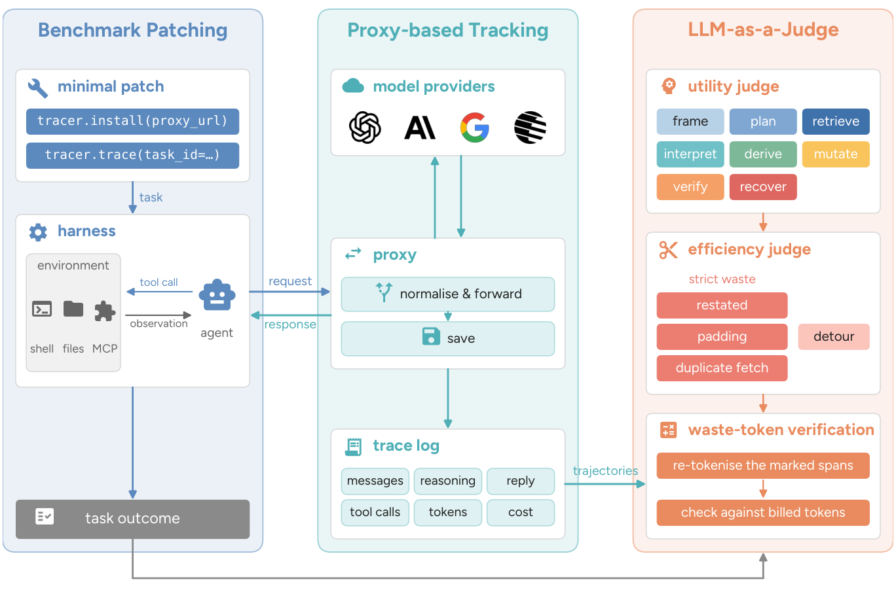

<div align="center">

# How Do AI Agents Waste Your Money?

**A framework for measuring token waste in AI agents: tracing proxy, patched benchmarks, and an LLM-as-a-Judge.**

[](https://agenteconomics.org/posts/how-agents-waste-money)
[](https://arxiv.org/abs/2611.07238)
[](https://agenteconomics.org/)
[](https://huggingface.co/datasets/huiminz3/How_Do_AI_Agents_Waste_Your_Money)
[](LICENSE)

</div>

AI agents consume tokens across a wide range of tasks, but how many of those tokens are
necessary? *Token cost* is the bill; *token waste* is the tokens that are useless and
removable in the agent's trajectory. This repository is the framework the paper builds to
measure the second. It works in three stages:

1. **Tracing** — heterogeneous benchmarks and harnesses are connected with a few lines of
   code; every model call goes through a proxy that records it, and the trajectories are
   normalised into one representation across models, benchmarks and harnesses.
2. **Identifying** — under a minimalism principle (a trajectory should contain no more
   generated content than the useful work needs), an LLM-as-a-Judge (LLMaJ) marks the
   removable spans in reasoning, visible responses and tool calls, as one of four patterns:
   *Restate*, *Duplicate-Fetch*, *Padding* (strict waste) and *Detour* (reasonable when
   attempted, unnecessary in hindsight).
3. **Verifying** — the marked spans are mapped back to the original trajectory and
   re-tokenised with the provider's own tokenizer, so waste is measured in the tokens and
   dollars the provider actually bills.



Three parts, one per column above: the benchmark patches, the tracing proxy, and LLMaJ.
The paper applies them to six frontier LLMs (Kimi-K3, Gemini 3.1 Pro, GPT-5.6 Terra, GPT-6
Astra, Claude Sonnet 5, Claude Fable 5.1) on four benchmarks (τ²-bench airline and retail,
SWE-bench Verified, Claw-Eval, MCP-Atlas), across four reasoning-effort levels of Kimi-K3,
and across five agent harnesses (OpenCode, OpenClaw, OpenHands, Hermes, Kimi Code CLI)
beside each benchmark's native harness.

## Table of Contents

- [Overview](#overview)
- [Installation](#installation)
- [Configuration](#configuration)
- [Quick Start](#quick-start)
- [Outputs](#outputs)
- [Run It on Your Own Agent](#run-it-on-your-own-agent)
- [Notes That Save a Wasted Run](#notes-that-save-a-wasted-run)
- [What the Patches Change](#what-the-patches-change)
- [Blog](#blog)
- [Citation](#citation)
- [Acknowledgements](#acknowledgements)
- [License](#license)

## Overview

| block | what it is |
|---|---|
| `benchmarks/<name>/` | For each of τ²-bench, claw-eval, mini-swe-agent (SWE-bench Verified) and MCP-Atlas: `UPSTREAM` (repo + pinned commit), `cost_tracking.patch` (the only change we make: route the agent through the proxy and tag each call with a trace id), `setup.sh`, `run.sh`. |
| `proxy/` | `llm_cost_tracker`: the LiteLLM proxy config (one alias per model × reasoning effort), the callback that writes one row per call (`trace_logger.py`), prices, and the client-side tracer the patches import. |
| `LLMaJ/` | The judge: trajectories → turns → three judgings per turn (utility, action, efficiency) → exact token counts, dollars, waste shares. [Its own README](LLMaJ/README.md) defines the waste categories and the output. |

Everything the repository produces lands under `artifacts/`: the agents' trajectories in
`artifacts/trajectories/`, the judge's output in `artifacts/llmaj/`. The trajectories the
paper judged, with their LLMaJ labels, are published as a dataset:
[huiminz3/How_Do_AI_Agents_Waste_Your_Money](https://huggingface.co/datasets/huiminz3/How_Do_AI_Agents_Waste_Your_Money).

## Installation

Requirements: Linux, Python 3.12 via [uv](https://docs.astral.sh/uv/), Docker (mini-swe-agent
and MCP-Atlas run tasks in containers), git.

```bash
cp .env.example .env            # 1. configure (below)
./setup.sh                      # 2. installs every block (or ./setup.sh proxy tau2-bench ...)
./run_proxy.sh                  # 3. the tracing proxy, :4000, in its own terminal
```

## Configuration

**Configure.** `.env` is the only place keys live, and it is git-ignored. Fill in:

| variable | needed for |
|---|---|
| `PROXY_API_KEY` | always — any string; the benchmarks send it to the proxy as their API key |
| `OPENAI_API_KEY`, `ANTHROPIC_API_KEY`, `GEMINI_API_KEY`, `KIMI_API_KEY` (+ `KIMI_BASE_URL`) | the aliases you will run or judge with: `gpt-*`, `claude-*`, `gemini-*`, `kimi-k3*` (see `proxy/llm_cost_tracker/proxy/config.yaml`). The τ² user simulator and the MCP-Atlas scorer call their provider directly, so they need that provider's key too |
| `benchmarks/mcp-atlas/src/.env` | MCP-Atlas only: the keys of its 36 tool servers, created from upstream's `env.template` by `setup.sh` |

Every script checks what it needs before spending and says which variable is missing;
an alias whose provider key is unset fails with a 401 at call time and nothing else.

## Quick Start

Then one benchmark, one small run, agent alias as `proxy/llm_cost_tracker/proxy/config.yaml` names it:

```bash
cd benchmarks/tau2-bench      && DOMAIN=retail NUM_TASKS=5 NUM_TRIALS=1 AGENT_MODEL=openai/kimi-k3-high USER_MODEL=claude-sonnet-5 ./run.sh
cd benchmarks/claw-eval       && CLAW_EVAL_MODEL=kimi-k3-high ./run.sh
cd benchmarks/mini-swe-agent  && MINI_SWE_MODEL=openai/kimi-k3-high MINI_SWE_SUBSET=verified MINI_SWE_SPLIT=test ./run.sh --slice 0:5
cd benchmarks/mcp-atlas       && MCP_MODEL=kimi-k3-high MCP_RUN_ID=first ./run.sh --num-tasks 5
```

Every call lands under `artifacts/trajectories/shared/no_key/<benchmark>/<domain>/<model>/trace_<id>/calls.jsonl`
with the four token counts, the reasoning and visible text, the tool calls, the
provider's cost and the parameters the call actually ran with. Then judge:

```bash
LLMaJ/proxy/run.sh                                   # the judge proxy, :4500, its own terminal
cd LLMaJ && ./run_llmaj.sh kimi-k3-high --only efficiency --benchmark tau2 --run first
```

## Outputs

Everything lands under `artifacts/`, which is git-ignored:

- `artifacts/trajectories/<owner>/<credential>/<benchmark>/<domain>/<model>/trace_<id>/calls.jsonl` —
  one row per model call: the four token counts, reasoning and visible text, tool calls,
  the provider's cost and the parameters the call actually ran with.
- `artifacts/llmaj/results/<task>/<judge>_llmaj/<run>/<alias>_agent/<cell>/` — one verdict
  file per trajectory beside the cell's `summary.json`, `exact_tokens.json` (tokens of the
  marked spans, counted with the model's own tokenizer, by kind and by stream) and
  `dollars.json`. [LLMaJ/README.md](LLMaJ/README.md) describes each file.

## Run It on Your Own Agent

Two files: [SKILL.md](SKILL.md) is written for your coding agent (hand it the file, or the
project page's prompt that points at it); [LLMaJ/SUBMISSION.md](LLMaJ/SUBMISSION.md) is the same
procedure for a person, with running the judge yourself as an alternative.
Send us your agent's trajectories and get them back with every removable span marked, plus the
waste ratio. The [project page](https://agenteconomics.org/posts/how-agents-waste-money/play) has the workflow: `LLMaJ/scripts_convert_trajectories.py`
turns the logs you already have (τ²-bench `results.json`, mini-swe-agent `.traj.json`, this
proxy's `calls.jsonl`, any OpenAI-style messages list) into the judge's JSONL and checks it; you
upload that to a public Hugging Face dataset and send us its name; we run the judge. The page's
[skill.md](https://agenteconomics.org/posts/how-agents-waste-money/skill.md) tells your own coding agent how to do all of that for you. The first
version lists results for the paper's four benchmarks; more to come.

## Notes That Save a Wasted Run

- **The proxy is the only thing a benchmark talks to.** Benchmarks send `PROXY_API_KEY`
  as their OpenAI key to `OPENAI_BASE_URL`; provider keys are read by the proxy alone.
  The effort level is chosen by alias (`kimi-k3-low` / `kimi-k3-high`, `claude-opus-5-medium`,
  `gpt-6-astra-xhigh` …) and recorded per row in `request_params`; harnesses send no
  effort parameter of their own. The reasons behind each alias's settings are in the
  config file's comments.
- **τ²-bench's user simulator is not traced.** It calls its provider directly
  (`USER_MODEL`; `claude-*` uses `ANTHROPIC_API_KEY`, anything else `OPENAI_API_KEY`),
  so only the agent's tokens are measured.
- **Grading is the benchmarks' own.** τ² and claw-eval grade as they run; SWE-bench patches
  are graded by the unmodified upstream evaluator (`benchmarks/mini-swe-agent/grade.sh`, pinned
  by its `setup.sh`); MCP-Atlas answers by its own LLM-as-judge claim scorer
  (`benchmarks/mcp-atlas/score.sh`). LLMaJ reads all four from `benchmarks/*/src/` for the
  per-trajectory outcomes (`LLMaJ/llmaj/paths.py` names the files).
- **MCP-Atlas** needs its own `benchmarks/mcp-atlas/src/.env` with the MCP servers' keys
  (`setup.sh` copies upstream's `env.template` there) and pulls `ghcr.io/scaleapi/mcp-atlas:1.2.7`.
  `MCP_RUN_ID` must differ between runs of the same model: the sandbox's trace ids are
  derived from it. Servers whose keys you leave empty show as offline and upstream's
  `run_all.sh` then refuses to start unless you pass `--skip-health-check`. It also reuses
  any agent harness already answering on its port (`PORT=` in `src/.env`, default 3001) —
  including one left behind by an interrupted run, with that run's settings — so when a run
  reports 404s from the model endpoint, look for a stale `node` on that port first.
  The Google Workspace server's OAuth refresh token expires; `benchmarks/mcp-atlas/google_refresh_token.py`
  obtains a new one (browser sign-in) and writes it into `src/.env`.
- **A re-run of a model writes into the same `artifacts/trajectories/` directory** as the first run. LLMaJ
  discovers one cell per `<benchmark>/<domain>/<alias>` and reads every run in it; to judge
  one run only, pin its run id with a `Cell(...)` in `LLMaJ/llmaj/preprocess/sources.py`.
- **Adding a model** not already configured: an alias in the proxy config, a price in
  `LLMaJ/llmaj/prices.py`, and a tokenizer choice in `LLMaJ/llmaj/aggregate/exact_tokens.py`.
- Never commit `.env`, `artifacts/` or `benchmarks/*/src/` (all git-ignored): the first holds
  keys, the second is tens of GB in a real run, the third is reproduced by `setup.sh`.

## What the Patches Change

Each `cost_tracking.patch` is a diff against the commit in `UPSTREAM`, applied by `setup.sh`
(`git apply`, then committed inside `src/` so `git diff HEAD~1` shows it). They add the
`llm_cost_tracker.tracer` import that stamps a trace header (benchmark, domain, model,
run id, task id) on every outgoing call, point the agent's client at the proxy, and
nothing else: no prompt, tool or scoring change. Sizes: τ²-bench 3 files, claw-eval 3,
mini-swe-agent 3, MCP-Atlas 6 (its Makefile also pins the MCP SDK the sandbox resolves at
start, which otherwise silently drops a quarter of the tool servers).

## Blog

More of our work on agent token efficiency is written up as blog posts at
[agenteconomics.org](https://agenteconomics.org/).

## Citation

If you use this framework or its measurements, please cite the paper:

```bibtex
@misc{zeng2026aiagentswastemoney,
  title         = {How Do AI Agents Waste Your Money?},
  author        = {Huimin Zeng and Yuxuan Lu and Jesse Cai and Eric Hanchen Jiang and Di Wu and Po-Nien Kung and Wenbo Hu and Ziyi Wang and Dakuo Wang and Jiaxin Pei and Kai-Wei Chang},
  year          = {2026},
  eprint        = {2611.07238},
  archivePrefix = {arXiv},
  primaryClass  = {cs.CL},
  url           = {https://arxiv.org/abs/2611.07238}
}
```

## Acknowledgements

The benchmarks are the upstream projects, used at the commits pinned in each
`benchmarks/<name>/UPSTREAM` with only the tracing patch applied:
[τ²-bench](https://github.com/sierra-research/tau2-bench),
[claw-eval](https://github.com/claw-eval/claw-eval),
[mini-swe-agent](https://github.com/SWE-agent/mini-swe-agent) with the
[SWE-bench](https://github.com/SWE-bench/SWE-bench) evaluator, and
[MCP-Atlas](https://github.com/scaleapi/mcp-atlas). The proxy is built on
[LiteLLM](https://github.com/BerriAI/litellm).

## License

This repository is released under the [MIT License](LICENSE). The benchmarks it patches are
checked out from their own repositories by `setup.sh` and keep their own licenses; the
labeled trajectories on Hugging Face are released under CC BY 4.0.
